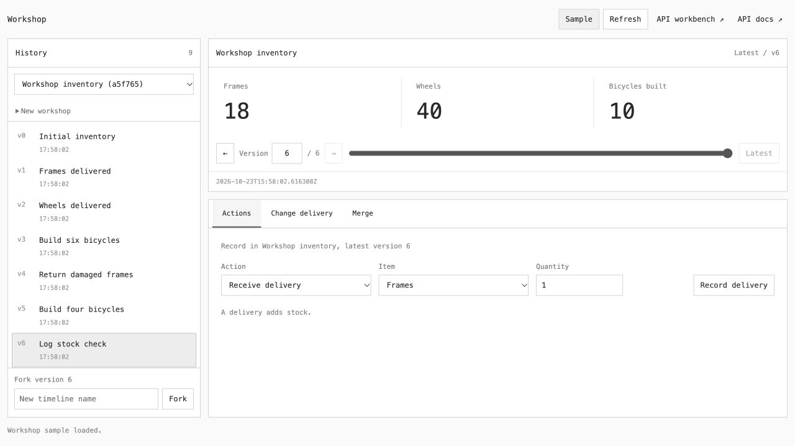
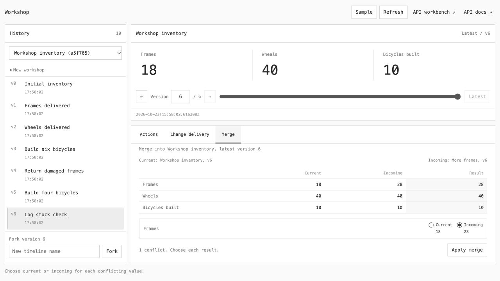

# TimeMachineAPI

A local Python API for recording JSON changes, inspecting past state, and comparing alternative histories. Built with FastAPI, SQLite, and plain JavaScript, it includes a bicycle workshop for deliveries, builds, returns, and inventory corrections.

## Run locally

Use Python 3.12 and uv. Open Terminal and run these commands.

```text
git clone https://github.com/landfvit/time-machine-api.git
cd time-machine-api
uv sync --locked --extra dev
uv run uvicorn app:app --host 127.0.0.1 --port 8001
```

Open the [workshop](http://127.0.0.1:8001/workshop) for the example application, the [workbench](http://127.0.0.1:8001/) for JSON editing, or the [API documentation](http://127.0.0.1:8001/docs) to try individual requests.

History persists in `.local/history.sqlite3`, which Git ignores. Set `TIMEMACHINE_DB` to choose another database path. Setting `TIMEMACHINE_API_KEY` requires an `X-API-Key` header on API requests. The local interfaces let you enter that key.

## How it works

Each timeline starts with a JSON document at version 0. Events record changes and advance the version. Reading an older version reconstructs its state while preserving newer events. Timestamp queries use server recording times.

A fork creates an independent timeline from a selected version. An experiment replaces an earlier event on a new branch and replays later events. Increasing a delivery changes subsequent inventory while preserving recorded builds and returns.

Use it to audit changes, investigate incorrect values, reproduce bugs, and review corrections before applying them. Your application sends changes through the API. It does not monitor applications automatically or predict outcomes.

Writes check the version the client last read to prevent conflicting updates. An `Idempotency-Key` lets clients retry requests without recording successful changes twice.

## Similarities to Git

| Git concept | TimeMachineAPI equivalent |
| --- | --- |
| Files | JSON state |
| Commits | Recorded events |
| Checking out an earlier commit | Reading a past state |
| Branch | Forked timeline |
| Merge | Three-way merge using shared history |

These ideas apply to application data. Merge compares final values against a shared base, preserves independent changes, and asks you to resolve conflicting values. It does not add inventory counts together or implement every Git feature.

## Workshop example

Click **Sample** to create a fresh history. Its latest version contains 18 frames, 40 wheels, and 10 built bicycles. Select history rows to inspect earlier inventory, then return to **Latest**.

Under **Actions**, receive parts, build bicycles, or return stock to the supplier. Each bicycle consumes one frame and two wheels. Invalid quantities and insufficient stock are rejected. To try actions separately, select a historical version, enter a new timeline name, and click **Fork**.



For the delivery example, use a fresh sample. Select **Frames delivered** at version 1 and open **Change delivery**. Name the new timeline `More frames`, change the quantity from 10 to 20, and click **Change and replay**. The alternative finishes with 28 frames. The original still has 18.

Select the original timeline and **Latest**, then open **Merge**. Choose `More frames` as the incoming timeline and click **Preview merge**. Choose **Incoming** for the frames conflict, then **Apply merge**. The original receives a new event with 28 frames, while earlier versions and the incoming history remain available.



Experiments cannot replace or replay merge events. Fork after the last merge to continue exploring later changes. Unrelated histories and histories with ambiguous merge bases are rejected.

## API example and checks

With the server running, open another Terminal window and run the Python example.

```text
uv run python examples/branch.py
uv run --extra dev pytest -q
```

Optional JavaScript syntax checks require Node.js.

```text
node --check static/app.js
node --check static/workshop.js
```
